<!-- Okładka profilu z0z6. Generowana automatycznie przez _generator/build.py (.github/workflows/profile.yml) — nie edytuj ręcznie. -->

<a href="https://github.com/z0z6"><picture><source media="(prefers-color-scheme: dark)" srcset="assets/profile/hero-dark.svg"></picture></a>

 

<picture><source media="(prefers-color-scheme: dark)" srcset="assets/profile/section-00-dark.svg">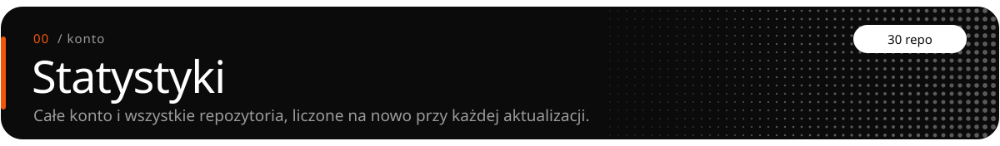</picture>

 

<picture><source media="(prefers-color-scheme: dark)" srcset="assets/profile/stats-dark.svg"></picture>

<picture><source media="(prefers-color-scheme: dark)" srcset="assets/profile/langs-dark.svg"></picture>

<picture><source media="(prefers-color-scheme: dark)" srcset="assets/profile/stats-repos-dark.svg"></picture>

 

<picture><source media="(prefers-color-scheme: dark)" srcset="assets/profile/section-01-dark.svg">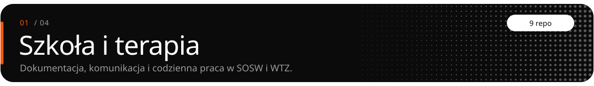</picture>

 

<a href="https://github.com/z0z6/dokshelper"><picture><source media="(prefers-color-scheme: dark)" srcset="assets/profile/feat-dokshelper-dark.svg"></picture></a>

<a href="https://github.com/z0z6/wtzhelper"><picture><source media="(prefers-color-scheme: dark)" srcset="assets/profile/card-wtzhelper-dark.svg">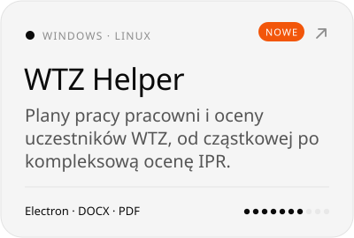</picture></a>
<a href="https://github.com/z0z6/gwarek"><picture><source media="(prefers-color-scheme: dark)" srcset="assets/profile/card-gwarek-dark.svg"></picture></a>
<a href="https://github.com/z0z6/dziennik"><picture><source media="(prefers-color-scheme: dark)" srcset="assets/profile/card-dziennik-dark.svg"></picture></a>

<a href="https://github.com/z0z6/skryba"><picture><source media="(prefers-color-scheme: dark)" srcset="assets/profile/card-skryba-dark.svg">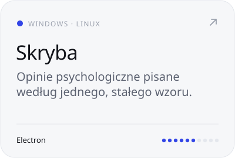</picture></a>
<a href="https://github.com/z0z6/monitor"><picture><source media="(prefers-color-scheme: dark)" srcset="assets/profile/card-monitor-dark.svg">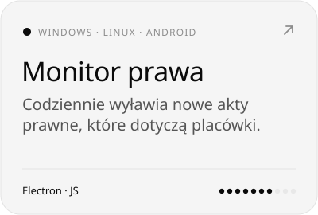</picture></a>
<a href="https://github.com/z0z6/lista"><picture><source media="(prefers-color-scheme: dark)" srcset="assets/profile/card-lista-dark.svg"></picture></a>

<a href="https://github.com/z0z6/inglisz"><picture><source media="(prefers-color-scheme: dark)" srcset="assets/profile/card-inglisz-dark.svg"></picture></a>
<a href="https://github.com/z0z6/inglisz2"><picture><source media="(prefers-color-scheme: dark)" srcset="assets/profile/card-inglisz2-dark.svg">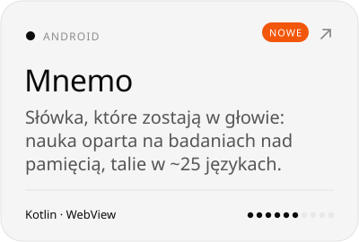</picture></a>

 

<picture><source media="(prefers-color-scheme: dark)" srcset="assets/profile/section-02-dark.svg"></picture>

 

<a href="https://github.com/z0z6/2FA2"><picture><source media="(prefers-color-scheme: dark)" srcset="assets/profile/card-2FA2-dark.svg">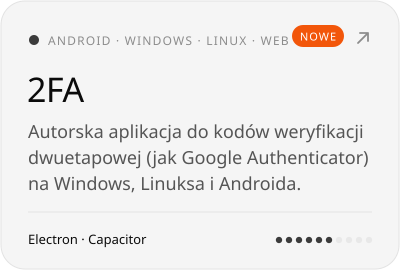</picture></a>
<a href="https://github.com/z0z6/szept"><picture><source media="(prefers-color-scheme: dark)" srcset="assets/profile/card-szept-dark.svg">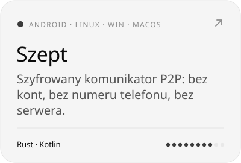</picture></a>
<a href="https://github.com/z0z6/QR"><picture><source media="(prefers-color-scheme: dark)" srcset="assets/profile/card-QR-dark.svg">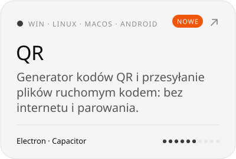</picture></a>

<a href="https://github.com/z0z6/tax"><picture><source media="(prefers-color-scheme: dark)" srcset="assets/profile/card-tax-dark.svg">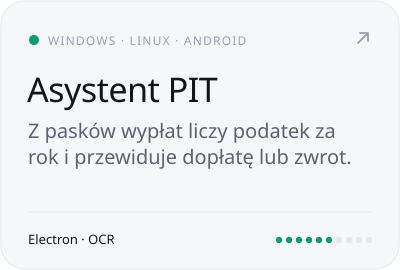</picture></a>
<a href="https://github.com/z0z6/watcher"><picture><source media="(prefers-color-scheme: dark)" srcset="assets/profile/card-watcher-dark.svg"></picture></a>
<a href="https://github.com/z0z6/Tracko"><picture><source media="(prefers-color-scheme: dark)" srcset="assets/profile/card-Tracko-dark.svg">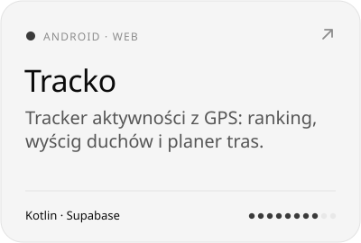</picture></a>

<a href="https://github.com/z0z6/cryptoscaner"><picture><source media="(prefers-color-scheme: dark)" srcset="assets/profile/card-cryptoscaner-dark.svg">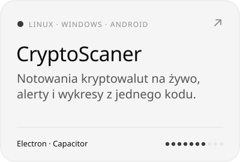</picture></a>
<a href="https://github.com/z0z6/cinemaker"><picture><source media="(prefers-color-scheme: dark)" srcset="assets/profile/card-cinemaker-dark.svg"></picture></a>
<a href="https://github.com/z0z6/melodico"><picture><source media="(prefers-color-scheme: dark)" srcset="assets/profile/card-melodico-dark.svg">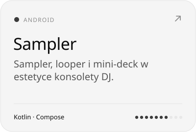</picture></a>

<a href="https://github.com/z0z6/steps"><picture><source media="(prefers-color-scheme: dark)" srcset="assets/profile/card-steps-dark.svg">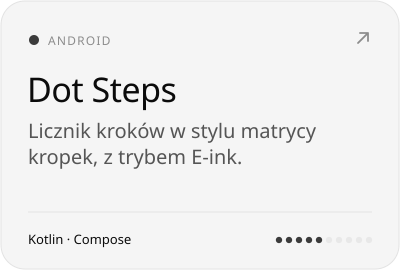</picture></a>
<a href="https://github.com/z0z6/vr"><picture><source media="(prefers-color-scheme: dark)" srcset="assets/profile/card-vr-dark.svg"></picture></a>

 

<picture><source media="(prefers-color-scheme: dark)" srcset="assets/profile/section-03-dark.svg">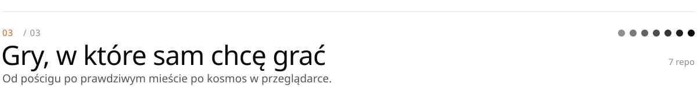</picture>

 

<a href="https://github.com/z0z6/metaverse"><picture><source media="(prefers-color-scheme: dark)" srcset="assets/profile/feat-metaverse-dark.svg">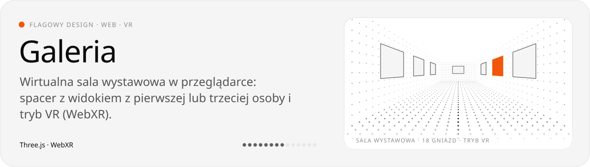</picture></a>

<a href="https://github.com/z0z6/foto"><picture><source media="(prefers-color-scheme: dark)" srcset="assets/profile/card-foto-dark.svg">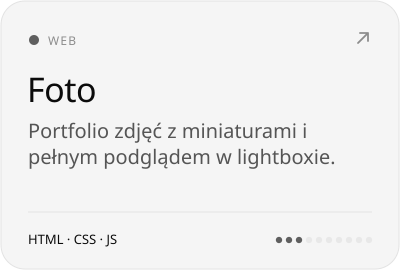</picture></a>
<a href="https://github.com/z0z6/rotacja"><picture><source media="(prefers-color-scheme: dark)" srcset="assets/profile/card-rotacja-dark.svg">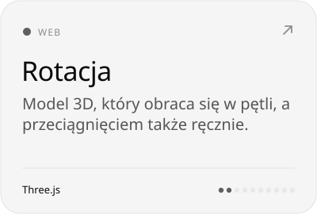</picture></a>
<a href="https://github.com/z0z6/odliczanie"><picture><source media="(prefers-color-scheme: dark)" srcset="assets/profile/card-odliczanie-dark.svg">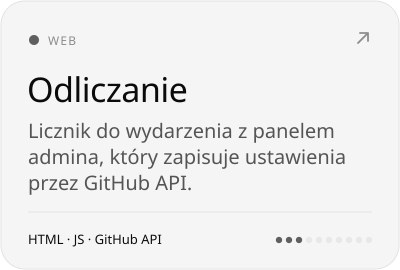</picture></a>

 

<picture><source media="(prefers-color-scheme: dark)" srcset="assets/profile/section-04-dark.svg">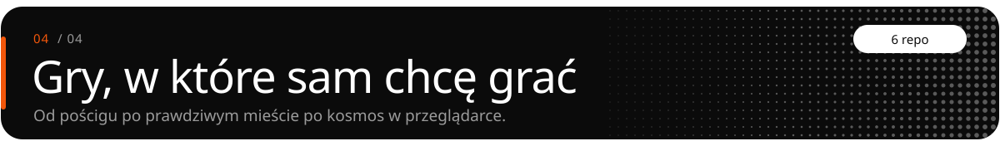</picture>

 

<a href="https://github.com/z0z6/GTA26"><picture><source media="(prefers-color-scheme: dark)" srcset="assets/profile/feat-GTA26-dark.svg">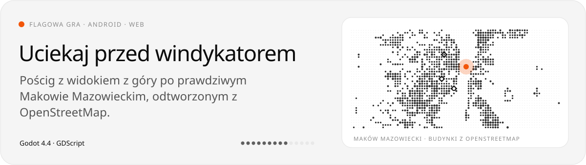</picture></a>

<a href="https://github.com/z0z6/Teegarden-B"><picture><source media="(prefers-color-scheme: dark)" srcset="assets/profile/card-Teegarden-B-dark.svg">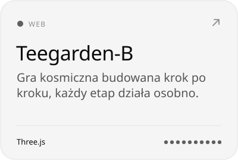</picture></a>
<a href="https://github.com/z0z6/8w1"><picture><source media="(prefers-color-scheme: dark)" srcset="assets/profile/card-8w1-dark.svg"></picture></a>
<a href="https://github.com/z0z6/TRON"><picture><source media="(prefers-color-scheme: dark)" srcset="assets/profile/card-TRON-dark.svg">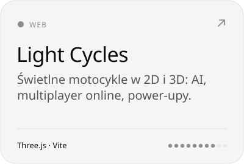</picture></a>

<a href="https://github.com/z0z6/SuperMayoBros"><picture><source media="(prefers-color-scheme: dark)" srcset="assets/profile/card-SuperMayoBros-dark.svg">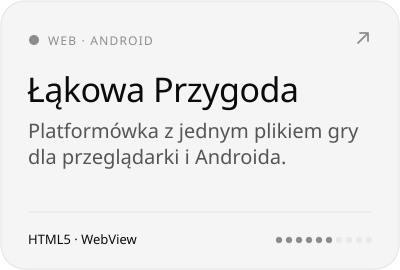</picture></a>
<a href="https://github.com/z0z6/brawl"><picture><source media="(prefers-color-scheme: dark)" srcset="assets/profile/card-brawl-dark.svg">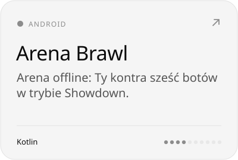</picture></a>

 

i jeszcze &nbsp;→&nbsp; <a href="https://github.com/z0z6/z0z6"><code>z0z6</code></a> strona z projektami

  

<picture><source media="(prefers-color-scheme: dark)" srcset="assets/profile/footer-dark.svg"></picture>

