<!-- Okładka profilu z0z6. Grafiki: assets/profile/*.svg (jasne i ciemne). -->

<a href="https://github.com/z0z6"><picture><source media="(prefers-color-scheme: dark)" srcset="assets/profile/hero-dark.svg"></picture></a>

 

<picture><source media="(prefers-color-scheme: dark)" srcset="assets/profile/langs-dark.svg">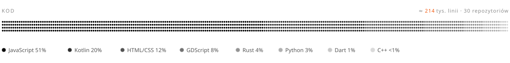</picture>

 

<picture><source media="(prefers-color-scheme: dark)" srcset="assets/profile/section-01-dark.svg"></picture>

 

<a href="https://github.com/z0z6/ipet-wopfu-helper"><picture><source media="(prefers-color-scheme: dark)" srcset="assets/profile/feat-ipet-wopfu-helper-dark.svg">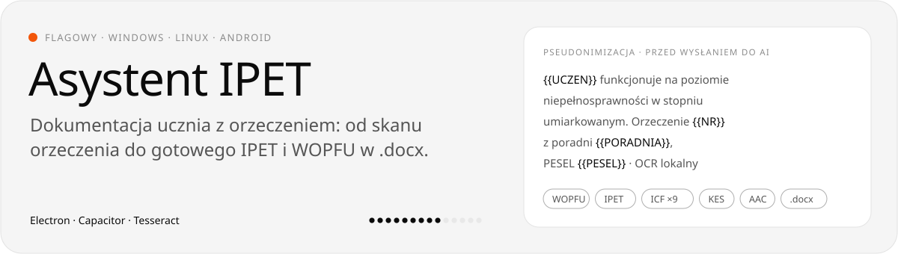</picture></a>

<a href="https://github.com/z0z6/gwarek"><picture><source media="(prefers-color-scheme: dark)" srcset="assets/profile/card-gwarek-dark.svg">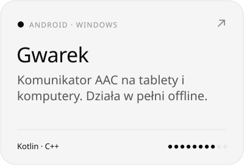</picture></a>
<a href="https://github.com/z0z6/dziennik"><picture><source media="(prefers-color-scheme: dark)" srcset="assets/profile/card-dziennik-dark.svg">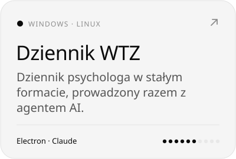</picture></a>
<a href="https://github.com/z0z6/skryba"><picture><source media="(prefers-color-scheme: dark)" srcset="assets/profile/card-skryba-dark.svg"></picture></a>

<a href="https://github.com/z0z6/minitor"><picture><source media="(prefers-color-scheme: dark)" srcset="assets/profile/card-minitor-dark.svg">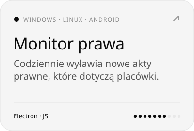</picture></a>
<a href="https://github.com/z0z6/lista"><picture><source media="(prefers-color-scheme: dark)" srcset="assets/profile/card-lista-dark.svg">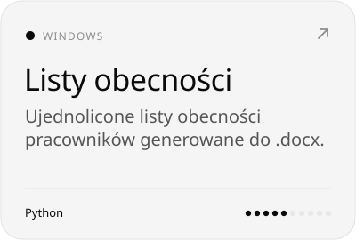</picture></a>
<a href="https://github.com/z0z6/inglisz"><picture><source media="(prefers-color-scheme: dark)" srcset="assets/profile/card-inglisz-dark.svg">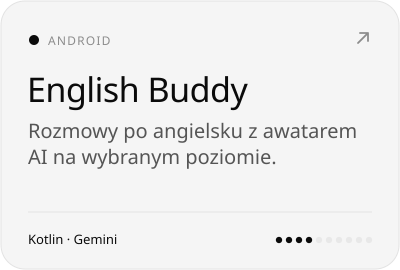</picture></a>

 

<picture><source media="(prefers-color-scheme: dark)" srcset="assets/profile/section-02-dark.svg">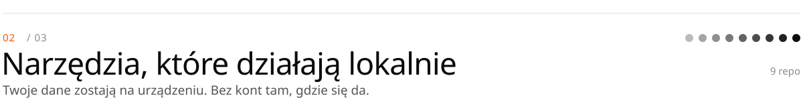</picture>

 

<a href="https://github.com/z0z6/szept"><picture><source media="(prefers-color-scheme: dark)" srcset="assets/profile/card-szept-dark.svg"></picture></a>
<a href="https://github.com/z0z6/tax"><picture><source media="(prefers-color-scheme: dark)" srcset="assets/profile/card-tax-dark.svg"></picture></a>
<a href="https://github.com/z0z6/watcher"><picture><source media="(prefers-color-scheme: dark)" srcset="assets/profile/card-watcher-dark.svg">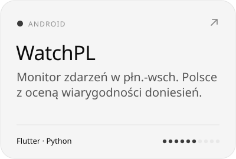</picture></a>

<a href="https://github.com/z0z6/Tracko"><picture><source media="(prefers-color-scheme: dark)" srcset="assets/profile/card-Tracko-dark.svg"></picture></a>
<a href="https://github.com/z0z6/cointracko"><picture><source media="(prefers-color-scheme: dark)" srcset="assets/profile/card-cointracko-dark.svg">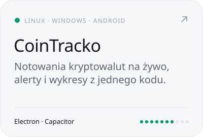</picture></a>
<a href="https://github.com/z0z6/cinemaker"><picture><source media="(prefers-color-scheme: dark)" srcset="assets/profile/card-cinemaker-dark.svg">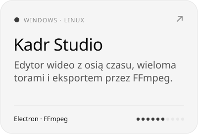</picture></a>

<a href="https://github.com/z0z6/melodico"><picture><source media="(prefers-color-scheme: dark)" srcset="assets/profile/card-melodico-dark.svg"></picture></a>
<a href="https://github.com/z0z6/steps"><picture><source media="(prefers-color-scheme: dark)" srcset="assets/profile/card-steps-dark.svg"></picture></a>
<a href="https://github.com/z0z6/vr"><picture><source media="(prefers-color-scheme: dark)" srcset="assets/profile/card-vr-dark.svg">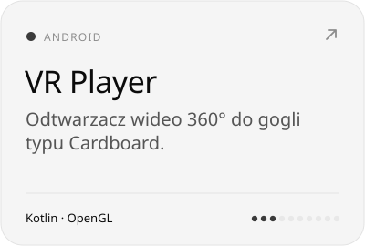</picture></a>

 

<picture><source media="(prefers-color-scheme: dark)" srcset="assets/profile/section-03-dark.svg"></picture>

 

<a href="https://github.com/z0z6/GTA26"><picture><source media="(prefers-color-scheme: dark)" srcset="assets/profile/feat-GTA26-dark.svg"></picture></a>

<a href="https://github.com/z0z6/Teegarden-B"><picture><source media="(prefers-color-scheme: dark)" srcset="assets/profile/card-Teegarden-B-dark.svg"></picture></a>
<a href="https://github.com/z0z6/8w1"><picture><source media="(prefers-color-scheme: dark)" srcset="assets/profile/card-8w1-dark.svg">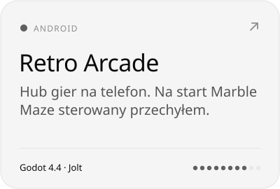</picture></a>
<a href="https://github.com/z0z6/TRON"><picture><source media="(prefers-color-scheme: dark)" srcset="assets/profile/card-TRON-dark.svg"></picture></a>

<a href="https://github.com/z0z6/SuperMayoBros"><picture><source media="(prefers-color-scheme: dark)" srcset="assets/profile/card-SuperMayoBros-dark.svg"></picture></a>
<a href="https://github.com/z0z6/metaverse"><picture><source media="(prefers-color-scheme: dark)" srcset="assets/profile/card-metaverse-dark.svg">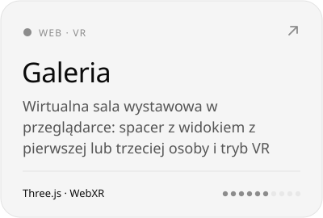</picture></a>
<a href="https://github.com/z0z6/brawl"><picture><source media="(prefers-color-scheme: dark)" srcset="assets/profile/card-brawl-dark.svg"></picture></a>

 

drobiazgi &nbsp;→&nbsp; <a href="https://github.com/z0z6/foto"><code>foto</code></a> galeria zdjęć &nbsp;·&nbsp; <a href="https://github.com/z0z6/odliczanie"><code>odliczanie</code></a> licznik z panelem &nbsp;·&nbsp; <a href="https://github.com/z0z6/rotacja"><code>rotacja</code></a> obracany model 3D &nbsp;·&nbsp; <a href="https://github.com/z0z6/z0z6"><code>z0z6</code></a> strona z projektami

  

<picture><source media="(prefers-color-scheme: dark)" srcset="assets/profile/footer-dark.svg"></picture>

